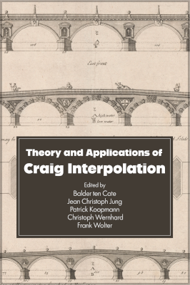

The volume ['Theory and Applications of Craig Interpolation'](https://ubiquitypress.com/chapters/e/10.5334/bdg.o) has been officially published by Ubiquity Press. Craig Interpolation, and the related topic Beth definability, is a foundational topic that played a central role in the field of modern logic since the mid-twentieth century, and provides a fundamental tool for understanding logical systems and how information can be transferred, transformed, or restricted within formal languages. Modern applications range from knowledge representation, program verification and data base theory to research in mathematics and philosophy. The volume brings together leading researchers from these disciplines to offer a comprehensive and contemporary account of developments in interpolation and definability. Accessible to graduate students yet rich in material for specialists, it offers an authoritative overview of Craig Interpolation and Beth Definability. It presents a broad and evolving research landscape, demonstrating how classical concepts remain essential in addressing contemporary questions about logical inference, expressiveness, and computation.

